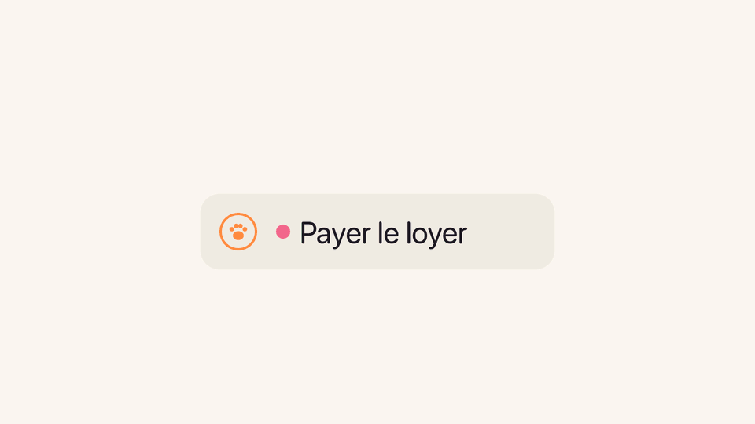
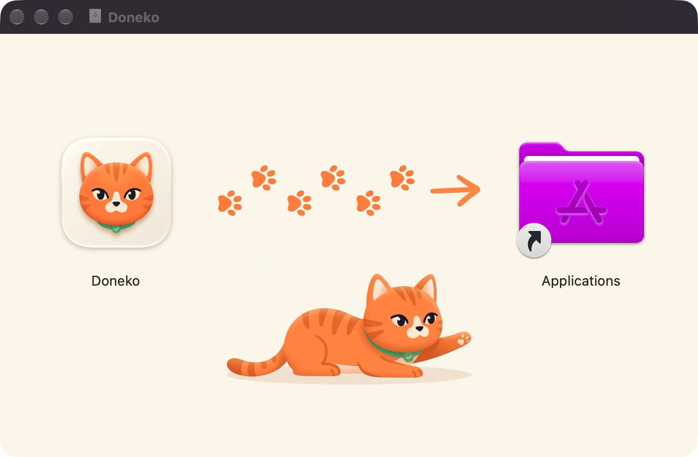

<p align="center">
  
</p>

<h1 align="center">Doneko</h1>

<p align="center">
  La petite to-do de la barre de menu macOS, avec son app iPhone, qui fait tomber tes tâches de la table, comme un chat.
</p>

<p align="center">
  <a href="https://github.com/nathm1609/Doneko/releases/latest"></a>
  
  
  <a href="LICENSE"></a>
</p>

<p align="center">
  <a href="https://github.com/nathm1609/Doneko/releases/latest/download/Doneko.dmg"><b>Télécharger Doneko.dmg</b></a>
  &nbsp;·&nbsp;
  <a href="#installation">Installation</a>
  &nbsp;·&nbsp;
  <a href="#iphone">iPhone</a>
  &nbsp;·&nbsp;
  <a href="#utilisation">Utilisation</a>
  &nbsp;·&nbsp;
  <a href="#compiler-depuis-les-sources">Compiler</a>
</p>

<p align="center">
  
  <br>
  <sub><a href="docs/videos/doneko.mp4">Voir la vidéo avec le son</a></sub>
</p>

**Doneko** (*done* + *neko*, « chat » en japonais) vit dans la barre de menu. Un clic sur la tête de chat,
ou <kbd>⌃</kbd><kbd>⌥</kbd><kbd>⌘</kbd><kbd>D</kbd> depuis n'importe où, ouvre un panneau : on tape ce qu'il reste à faire,
et un clic sur une tâche la fait tomber de la table d'un coup de patte. L'app iPhone partage la même liste par
iCloud Drive.

## Fonctionnalités

**Noter vite**
- Le curseur est dans le champ dès l'ouverture, <kbd>Entrée</kbd> ajoute la tâche et garde le focus.
- Un `!` en fin de saisie et la tâche devient prioritaire : elle remonte en haut, avec un point rose.
- Dates en français : « demain », « lundi », « le 20 », « le 25 décembre »… en fin de saisie fixent l'échéance ; les
  tâches à venir attendent dans « Plus tard » et remontent dans « Aujourd'hui » le jour venu.
- Ou le **bouton calendrier** au bout du champ : un clic sur un jour, et la prochaine tâche est pour ce jour-là.
  Clic droit sur une tâche › « Échéance… » pour changer ou retirer sa date.
- `#courses` dans la saisie range la tâche dans le dossier « courses », créé au besoin.

**Ranger**
- Une barre de dossiers sous le champ : « Tout », tes dossiers, « + ». Le dossier choisi filtre la liste et reçoit
  les nouvelles tâches ; <kbd>⌘</kbd><kbd>1</kbd> à <kbd>⌘</kbd><kbd>9</kbd> pour passer de l'un à l'autre.
- Clic droit sur une tâche : « Ranger dans ». Clic droit sur un dossier : renommer, déplacer, supprimer (ses tâches
  reviennent dans « Tout », avec annulation).

**Faire tomber**
- **Le coup de patte** : une vraie patte rousse pousse la tâche cochée hors de la table, un toast permet d'annuler
  pendant 5 secondes.
- **« Tombé aujourd'hui »** : les tâches faites restent visibles jusqu'au lendemain, puis disparaissent toutes seules.
- Glisser-déposer pour réordonner, double-clic pour modifier, glissement à deux doigts vers la gauche pour supprimer.

**Un chat qui vit**
- La tête de chat de la barre de menu saute quand une tâche arrive, donne un coup de patte quand elle tombe, cligne
  des yeux et s'endort quand il n'y a plus rien à faire aujourd'hui.
- Dans le panneau vide, le chat fait la sieste (il respire, ses « z » montent) ou saute de joie quand tout est fait.

**Avec le reste du Mac**
- **Rappels** : une notification le jour de l'échéance, à l'heure choisie.
- **Export Obsidian** : les tâches faites s'ajoutent à la note du jour de ton coffre, y compris celles cochées sur
  l'iPhone.
- **Synchronisation iCloud Drive** entre tes Mac et ton iPhone, fusionnée tâche par tâche : rien n'est perdu quand
  deux appareils modifient la liste hors ligne.

**Sur l'iPhone**
- La même liste, les mêmes dossiers et le même coup de patte, avec une petite vibration. La saisie est en bas, à
  portée de pouce.
- Balayer pour supprimer, toucher le texte pour modifier, appui long pour « Prioritaire » et « Ranger dans ».
- Le nombre de tâches du jour en pastille sur l'icône, et les rappels des échéances.
- Mode clair et sombre, « Réduire les animations » respecté, VoiceOver, interface entièrement en français.

## Aperçu

<p align="center">
  
  &nbsp;
  
</p>

<p align="center">
  
  &nbsp;
  
</p>

<p align="center">
  
  &nbsp;
  
</p>

<p align="center">
  
  <br>
  <sub>La tête de chat de la barre de menu</sub>
</p>

## Installation

1. Télécharge **[Doneko.dmg](https://github.com/nathm1609/Doneko/releases/latest/download/Doneko.dmg)**
   (macOS 14 Sonoma ou plus récent, Mac Apple Silicon ou Intel).
2. Ouvre-le et glisse **Doneko** dans **Applications**.
3. Lance Doneko depuis Applications : la tête de chat apparaît dans la barre de menu.

<p align="center">
  
</p>

> [!IMPORTANT]
> **Au premier lancement, macOS bloque l'app** : elle n'est pas notarisée par Apple (il faudrait un compte
> Apple Developer payant). Pour l'autoriser une fois pour toutes, ouvre **Réglages Système › Confidentialité et
> sécurité**, descends jusqu'au message sur Doneko et clique sur **Ouvrir quand même**. Ou, dans le Terminal :
>
> ```bash
> xattr -dr com.apple.quarantine /Applications/Doneko.app
> ```

macOS demande ensuite l'autorisation pour les notifications, iCloud Drive ou le dossier Obsidian au moment où
Doneko en a besoin. Pour qu'il se lance à l'ouverture de session, active « Lancer au démarrage » dans les réglages.

## iPhone

L'app iPhone n'est pas sur l'App Store : elle s'installe depuis Xcode, avec un simple compte Apple (gratuit).

1. Compile le projet comme indiqué dans [Compiler depuis les sources](#compiler-depuis-les-sources), puis ouvre
   `Doneko.xcodeproj` dans Xcode.
2. Dans `project.yml`, remplace `DEVELOPMENT_TEAM` par ton équipe (Xcode › Réglages › Comptes), puis relance
   `xcodegen generate`.
3. Branche ton iPhone, active le **Mode développeur** (Réglages › Confidentialité et sécurité), choisis le schéma
   **DonekoiOS** et ton iPhone, puis <kbd>⌘</kbd><kbd>R</kbd>. La première fois, autorise le développeur sur l'iPhone
   (Réglages › Général › VPN et gestion de l'appareil).

> [!NOTE]
> Avec un compte gratuit, l'app installée **expire au bout de 7 jours** : relance-la depuis Xcode pour une nouvelle
> semaine. Tes tâches restent.

**Synchroniser avec le Mac**
1. Mets **tous tes Mac** à jour en Doneko 1.2 : la version 1.1 ne sait pas lire la liste avec dossiers.
2. Sur le Mac : Réglages › **Synchroniser avec iCloud Drive**.
3. Sur l'iPhone : ⚙︎ › **Choisir le dossier Doneko…** › iCloud Drive › Doneko.

La liste se met à jour à l'ouverture, toutes les 5 secondes pendant que l'app est ouverte, et quand on tire la liste
vers le bas. iCloud Drive met de quelques secondes à une minute à faire passer un changement.

## Utilisation

### Saisie

| Tu tapes | Résultat |
|---|---|
| `Payer le loyer !` | Tâche prioritaire, en haut de la liste |
| `Appeler le véto demain` | « Appeler le véto », pour demain |
| `Courses lundi` | Pour lundi prochain |
| `Réserver le resto pour le 14` | Pour le 14 (ce mois-ci, ou le suivant s'il est passé) |
| `Examen pour le 25 décembre` | Pour le 25 décembre (cette année, ou la suivante s'il est passé) |
| `Impôts le 15 mai 2028` | Pour le 15 mai 2028 |
| `Gâteau après-demain !` | Prioritaire, pour après-demain |
| `Lait #courses demain !` | Dans le dossier « courses », prioritaire, pour demain |

Mots reconnus en fin de saisie : `aujourd'hui`, `demain`, `après-demain`, `lundi` … `dimanche`, `le 20`, `le 1er`,
`le 25 décembre`, `14 juillet 2028` (accents facultatifs), précédés ou non de `pour`. Le `!` et la date se combinent dans n'importe quel ordre. Le `#dossier` peut être placé
n'importe où ; en modifiant une tâche, il la range ailleurs.

### Clavier

| Touche | Action |
|---|---|
| <kbd>⌃</kbd><kbd>⌥</kbd><kbd>⌘</kbd><kbd>D</kbd> | Ouvrir le panneau (raccourci modifiable) |
| <kbd>Entrée</kbd> | Ajouter la tâche |
| <kbd>↑</kbd> <kbd>↓</kbd> | Choisir une tâche (champ vide) |
| <kbd>Espace</kbd> | Faire tomber la tâche choisie |
| <kbd>⌫</kbd> | Supprimer la tâche choisie |
| <kbd>⌘</kbd><kbd>Z</kbd> | Annuler |
| <kbd>⌘</kbd><kbd>1</kbd> | Dossier « Tout » |
| <kbd>⌘</kbd><kbd>2</kbd> … <kbd>⌘</kbd><kbd>9</kbd> | Les dossiers, dans l'ordre de la barre |
| <kbd>Échap</kbd> | Fermer le panneau |
| <kbd>⌘</kbd><kbd>Q</kbd> | Quitter |

Clic droit sur l'icône de la barre de menu : **Réglages…** et **Quitter**.

### Gestes sur l'iPhone

| Geste | Action |
|---|---|
| Toucher le rond | Faire tomber la tâche (« Annuler » pendant 5 secondes) |
| Toucher le texte | Modifier la tâche |
| Balayer vers la gauche | Supprimer |
| Bouton calendrier, au bout du champ | Choisir le jour de la prochaine tâche |
| Appui long | Prioritaire, Échéance…, Ranger dans, Supprimer |
| Appui long puis glisser | Changer la tâche de place |
| Appui long sur un dossier | Renommer, déplacer, supprimer |
| Tirer la liste vers le bas | Relire la liste partagée avec le Mac |

### Réglages

<p align="center">
  
</p>

- **Raccourci** pour appeler Doneko.
- **Heure de vidage** de « Tombé aujourd'hui » (minuit par défaut).
- **Rappels** des tâches datées : heure de la notification, ou jamais.
- **Son** : un petit « pop » quand une tâche tombe.
- **Compteur** des tâches du jour à côté de l'icône.
- **Export Obsidian** : chaque tâche faite s'ajoute à la note `AAAA-MM-JJ.md` du dossier choisi, sous
  `## Fait avec Doneko`. Le reste de la note n'est jamais modifié ; décocher une tâche retire sa ligne.
- **Synchronisation iCloud Drive** : la liste passe dans `iCloud Drive/Doneko/todos.json` et se met à jour quand
  un autre Mac ou l'iPhone la change. Les deux versions sont fusionnées tâche par tâche : la modification la plus
  récente de chaque tâche gagne, et une suppression l'emporte pendant 30 jours.
- **Lancer au démarrage.**

Sans synchronisation, les tâches sont enregistrées dans `~/Library/Application Support/Doneko/todos.json`.

Sur l'iPhone, le bouton ⚙︎ ouvre les mêmes réglages, ou presque : synchronisation avec le Mac, heure de vidage,
rappels, « pop » et pastille sur l'icône. Quand la liste est partagée, l'iPhone masque les tâches de la veille sans
les effacer : le Mac les exporte dans Obsidian, puis les vide.

## Compiler depuis les sources

**Prérequis** : Xcode (le projet est développé avec Xcode 27) et [XcodeGen](https://github.com/yonaskolb/XcodeGen).

```bash
brew install xcodegen
git clone https://github.com/nathm1609/Doneko.git
cd Doneko
xcodegen generate
xcodebuild -project Doneko.xcodeproj -scheme Doneko -configuration Debug -derivedDataPath build build
open build/Build/Products/Debug/Doneko.app
```

L'app iPhone, dans le simulateur :

```bash
xcodebuild -project Doneko.xcodeproj -scheme DonekoiOS -configuration Debug -destination 'platform=iOS Simulator,name=iPhone 17 Pro' -derivedDataPath build build
```

> [!NOTE]
> Compile hors d'un dossier synchronisé par iCloud (comme `~/Documents`) : les attributs ajoutés par iCloud
> font échouer la signature.

## Développement

```bash
xcodebuild -project Doneko.xcodeproj -scheme Doneko -derivedDataPath build test
```

- Swift, SwiftUI et AppKit (`NSStatusItem` + `NSPanel`), framework Observation.
- `Shared/` est compilé dans les deux apps (`Doneko/` pour le Mac, `DonekoiOS/` pour l'iPhone) : modèle, store,
  persistance, thème, mascottes.
- Toute la logique vit dans `TodoStore`, testée avec XCTest (fusion, dossiers, purge…) ; l'heure est injectée pour
  tester les dates et la purge.
- Le projet Xcode est généré par XcodeGen à partir de `project.yml` : ne pas modifier le `.xcodeproj` à la main.
- La direction artistique (palette, typographie, animations, micro-textes) est décrite dans [`DESIGN.md`](DESIGN.md).
- Les illustrations sont dans `Artwork/` : `make-appicon.sh` génère l'icône, `make-mascots.swift` détoure les mascottes,
  `make-pop.py` génère le « pop » de l'iPhone.
- `./make-dmg.sh` compile la version Release et produit `build/Doneko.dmg`, à joindre tel quel à une release
  GitHub : le lien de téléchargement du README suppose ce nom. Le Finder enregistre la disposition de la fenêtre
  (fond, icônes) : macOS demande une fois l'autorisation de le piloter, et aucun volume Doneko ne doit être ouvert.

## Crédits

- [KeyboardShortcuts](https://github.com/sindresorhus/KeyboardShortcuts) de Sindre Sorhus pour le raccourci global.
- Icône et mascottes générées avec Gemini, puis retouchées pour l'app.

## Licence

Distribué sous licence [MIT](LICENSE).
