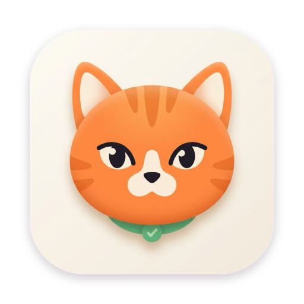
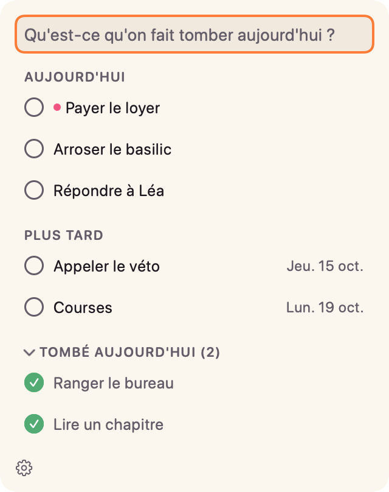
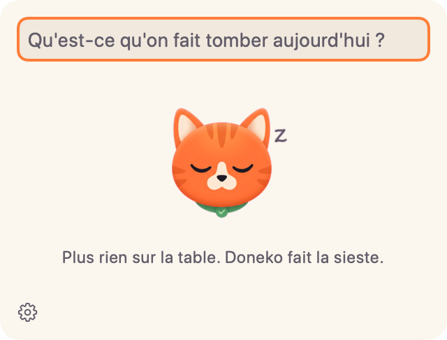
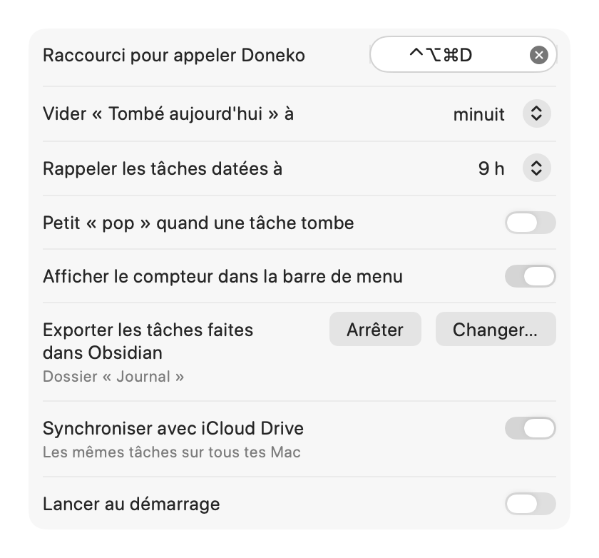

<p align="center">
  
</p>

<h1 align="center">Doneko</h1>

<p align="center">
  La petite to-do de la barre de menu macOS qui fait tomber tes tâches de la table, comme un chat.
</p>

---

**Doneko** (*done* + *neko*, « chat » en japonais) vit dans la barre de menu. Un clic sur la tête de chat,
ou <kbd>⌃</kbd><kbd>⌥</kbd><kbd>⌘</kbd><kbd>D</kbd> depuis n'importe où, ouvre un panneau : on tape ce qu'il reste à faire,
et un clic sur une tâche la fait tomber de la table d'un coup de patte.

<p align="center">
  
  &nbsp;
  
</p>

## Fonctionnalités

- **Rapide** : le curseur est dans le champ dès l'ouverture, <kbd>Entrée</kbd> ajoute la tâche et garde le focus.
- **Le coup de patte** : la tâche cochée tombe de la table, un toast permet d'annuler pendant 5 secondes.
- **« Tombé aujourd'hui »** : les tâches faites restent visibles jusqu'au lendemain, puis disparaissent toutes seules.
- **Priorités** : un `!` en fin de saisie et la tâche remonte en haut, avec un point rose.
- **Dates en français** : « demain », « lundi », « le 20 »… en fin de saisie fixent l'échéance ; les tâches à venir
  attendent dans « Plus tard » et remontent dans « Aujourd'hui » le jour venu.
- **Rappels** : une notification le jour de l'échéance, à l'heure choisie.
- **Glisser-déposer** pour réordonner, double-clic pour modifier, glissement à deux doigts vers la gauche pour supprimer.
- **Export Obsidian** : les tâches faites s'ajoutent à la note du jour de ton coffre.
- **Synchronisation iCloud Drive** entre tes Mac.
- **Mascotte** : le chat de la barre de menu dort quand il n'y a plus rien à faire aujourd'hui, et le panneau vide te félicite.
- Mode clair et sombre, « Réduire les animations » respecté, VoiceOver, interface entièrement en français.

<p align="center">
  
  &nbsp;
  
</p>

## Saisie

| Tu tapes | Résultat |
|---|---|
| `Payer le loyer !` | Tâche prioritaire, en haut de la liste |
| `Appeler le véto demain` | « Appeler le véto », pour demain |
| `Courses lundi` | Pour lundi prochain |
| `Réserver le resto pour le 14` | Pour le 14 (ce mois-ci, ou le suivant s'il est passé) |
| `Gâteau après-demain !` | Prioritaire, pour après-demain |

Mots reconnus en fin de saisie : `aujourd'hui`, `demain`, `après-demain`, `lundi` … `dimanche`, `le 20`, `le 1er`,
précédés ou non de `pour`. Le `!` et la date se combinent dans n'importe quel ordre.

## Clavier

| Touche | Action |
|---|---|
| <kbd>⌃</kbd><kbd>⌥</kbd><kbd>⌘</kbd><kbd>D</kbd> | Ouvrir le panneau (raccourci modifiable) |
| <kbd>Entrée</kbd> | Ajouter la tâche |
| <kbd>↑</kbd> <kbd>↓</kbd> | Choisir une tâche (champ vide) |
| <kbd>Espace</kbd> | Faire tomber la tâche choisie |
| <kbd>⌫</kbd> | Supprimer la tâche choisie |
| <kbd>⌘</kbd><kbd>Z</kbd> | Annuler |
| <kbd>Échap</kbd> | Fermer le panneau |
| <kbd>⌘</kbd><kbd>Q</kbd> | Quitter |

Clic droit sur l'icône de la barre de menu : **Réglages…** et **Quitter**.

## Réglages

<p align="center">
  
</p>

- **Raccourci** pour appeler Doneko.
- **Heure de vidage** de « Tombé aujourd'hui » (minuit par défaut).
- **Rappels** des tâches datées : heure de la notification, ou jamais.
- **Son** : un petit « pop » quand une tâche tombe.
- **Compteur** des tâches du jour à côté de l'icône.
- **Export Obsidian** : chaque tâche faite s'ajoute à la note `AAAA-MM-JJ.md` du dossier choisi, sous
  `## Fait avec Doneko`. Le reste de la note n'est jamais modifié ; décocher une tâche retire sa ligne.
- **Synchronisation iCloud Drive** : la liste passe dans `iCloud Drive/Doneko/todos.json` et se met à jour quand
  un autre Mac la change. C'est le dernier qui écrit qui gagne : évite de modifier sur deux Mac dans les mêmes secondes.
- **Lancer au démarrage.**

Sans synchronisation, les tâches sont enregistrées dans `~/Library/Application Support/Doneko/todos.json`.

## Installation

Doneko se compile depuis les sources.

**Prérequis** : macOS 14 Sonoma ou plus récent, Xcode (le projet est développé avec Xcode 27) et
[XcodeGen](https://github.com/yonaskolb/XcodeGen).

```bash
brew install xcodegen
git clone https://github.com/nathm1609/Doneko.git
cd Doneko
xcodegen generate
xcodebuild -project Doneko.xcodeproj -scheme Doneko -configuration Debug -derivedDataPath build build
open build/Build/Products/Debug/Doneko.app
```

L'app est signée localement (signature *ad hoc*) : au premier usage, macOS demande l'autorisation pour les
notifications, iCloud Drive ou le dossier Obsidian. Pour qu'elle se lance à l'ouverture de session, active
« Lancer au démarrage » dans les réglages.

> Compile hors d'un dossier synchronisé par iCloud (comme `~/Documents`) : les attributs ajoutés par iCloud
> font échouer la signature.

## Développement

```bash
xcodebuild -project Doneko.xcodeproj -scheme Doneko -derivedDataPath build test
```

- Swift, SwiftUI et AppKit (`NSStatusItem` + `NSPanel`), framework Observation.
- Toute la logique vit dans `TodoStore`, testée avec XCTest ; l'heure est injectée pour tester les dates et la purge.
- Le projet Xcode est généré par XcodeGen à partir de `project.yml` : ne pas modifier le `.xcodeproj` à la main.
- La direction artistique (palette, typographie, animations, micro-textes) est décrite dans [`DESIGN.md`](DESIGN.md).
- Les illustrations sont dans `Artwork/` : `make-appicon.sh` génère l'icône, `make-mascots.swift` détoure les mascottes.

## Crédits

- [KeyboardShortcuts](https://github.com/sindresorhus/KeyboardShortcuts) de Sindre Sorhus pour le raccourci global.
- Icône et mascottes générées avec Gemini, puis retouchées pour l'app.

## Licence

Distribué sous licence [MIT](LICENSE).
